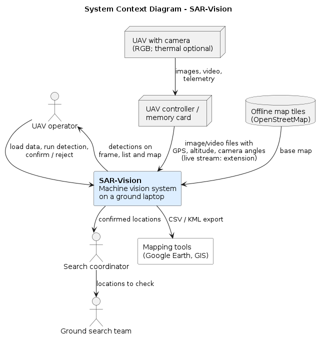
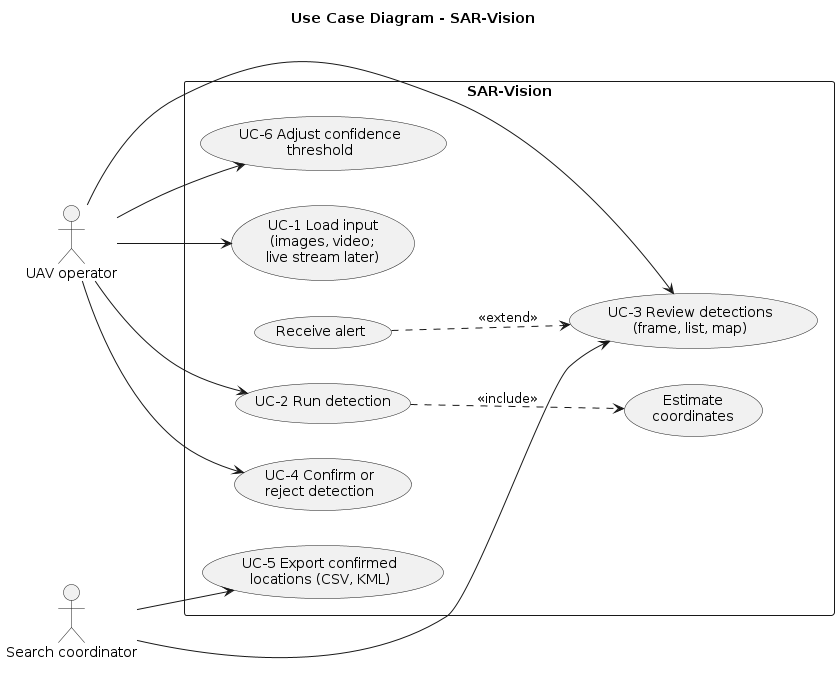
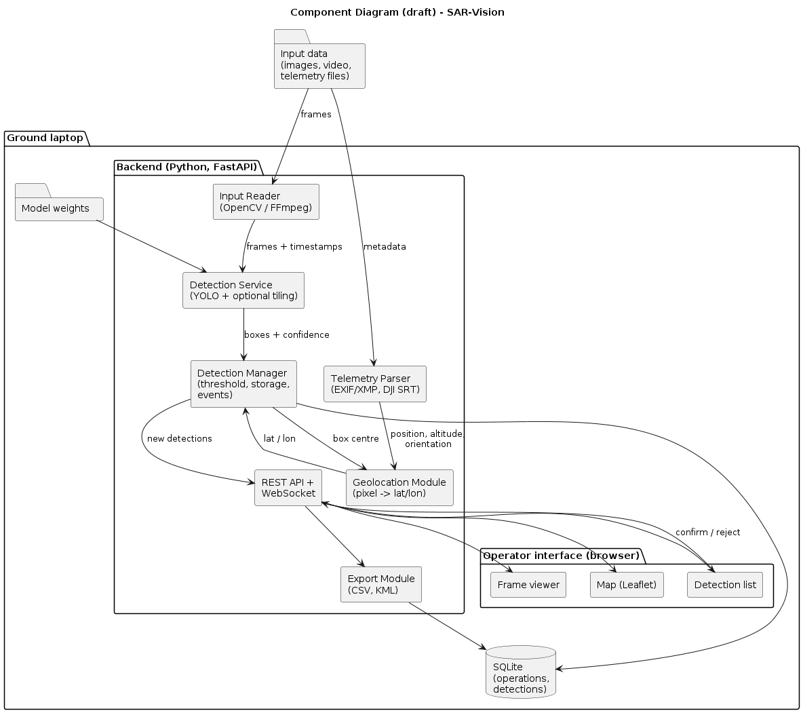

# 7. Architecture and Diagrams

This section describes the proposed architecture. Apart from a draft geolocation module (Section 7.4), none of the components has been implemented yet. The diagrams are drawn in PlantUML. Editable sources: https://github.com/assylzhan-se/uav-sar-vision/tree/prob-period-1/diagrams/src. Exported images: https://github.com/assylzhan-se/uav-sar-vision/tree/prob-period-1/diagrams/png.

## 7.1 System context

{width=85%}

SAR-Vision runs on a laptop at the ground station (Figure 1). In the MVP, the operator copies images or video and their telemetry from the UAV's memory card or controller. The system detects possible people, estimates their positions and shows the results on a frame, in a list and on an offline map. The operator reviews each detection. Confirmed locations are exported as CSV or KML for the search coordinator, who passes them to ground teams. Live stream input from the controller is planned as an extension.

## 7.2 Use cases

{width=85%}

| ID | Use case | Actor | Requirements |
|---|---|---|---|
| UC-1 | Load input (image folder, video file; live stream later) | Operator | FR-2, FR-9 |
| UC-2 | Run detection, including coordinate estimation | Operator | FR-1, FR-3, FR-4, FR-10 |
| UC-3 | Review detections on the frame, list and map | Operator, coordinator | FR-5, FR-11 |
| UC-4 | Confirm or reject a detection | Operator | FR-6 |
| UC-5 | Export confirmed locations | Coordinator | FR-7 |
| UC-6 | Adjust the confidence threshold | Operator | FR-8 |

## 7.3 Components (draft)

{width=100%}

| Component | Responsibility | Technology | Status |
|---|---|---|---|
| Input Reader | Reads images and video frames with timestamps | OpenCV, FFmpeg | Planned |
| Telemetry Parser | Extracts position, altitude and camera angles from image metadata or DJI SRT files | Python | Planned |
| Detection Service | Runs the person detector, optionally with tiling | Ultralytics YOLO, SAHI | Planned |
| Geolocation Module | Converts a pixel position into latitude and longitude | Python | Draft with unit tests |
| Detection Manager | Applies the threshold, stores detections, publishes events | Python | Planned |
| REST API and WebSocket | Connects the backend and the interface | FastAPI | Planned |
| Export Module | Writes CSV and KML files | Python | Planned |
| Operator interface | Frame viewer, map and detection list with confirm/reject | React or Vue, Leaflet | Mockups only (Section 8) |
| Storage | Operations and detections | SQLite | Planned |

The draft data model has two main entities:

- `Operation(id, name, created_at, notes)`
- `Detection(id, operation_id, source_file, frame_time, bbox, confidence, lat, lon, status, note, reviewed_at)`

Here `status` takes the values `new`, `confirmed` or `rejected`.

## 7.4 Geolocation method and assumptions

For the MVP, geolocation assumes a camera pointing straight down (nadir) over approximately flat terrain:

1. The ground sample distance (GSD), in metres per pixel, is GSD = (H × s~w~) / (f × W), where H is the height above ground, s~w~ is the sensor width, f is the focal length and W is the image width in pixels.
2. The detection's offset from the image centre is converted to metres: dx = (u − W/2) × GSD to the right and dy = (V/2 − v) × GSD forward, where (u, v) is the pixel position and V is the image height.
3. The offset is rotated by the camera's heading (gimbal yaw) into east and north components.
4. These components are added to the UAV position using a local approximation: Δlat = d~N~ / 111 320 and Δlon = d~E~ / (111 320 × cos(lat)).

This approach has known error sources:

- DJI metadata usually reports altitude relative to the take-off point, not height above the ground directly below the UAV. Terrain differences therefore cause scale errors.
- GNSS position error, heading error and gimbal angles that are not exactly vertical all add to the result.
- Lens distortion is ignored.
- For video, frames must be matched to telemetry records by time.

A draft of steps 1–4 has been written in Python (`src/sar_vision/geolocation.py`), with six unit tests that pass locally. It has not yet been validated against real flight data; that is test T-4. Support for tilted cameras (FR-13) would require projecting the viewing ray onto the ground and is planned only as an extension.
