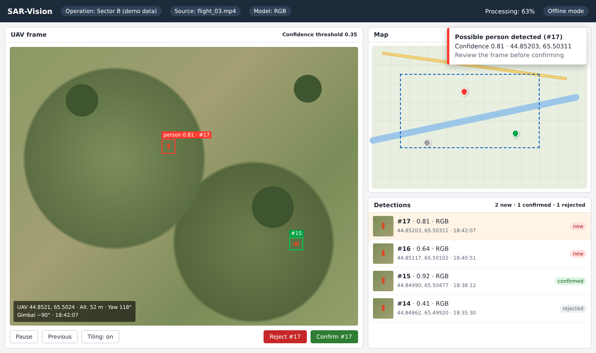
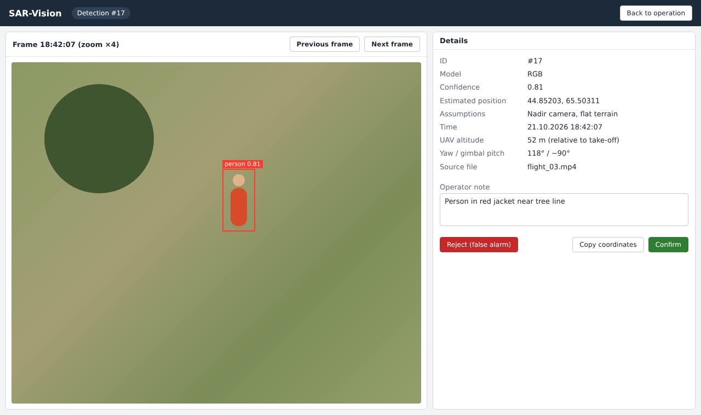
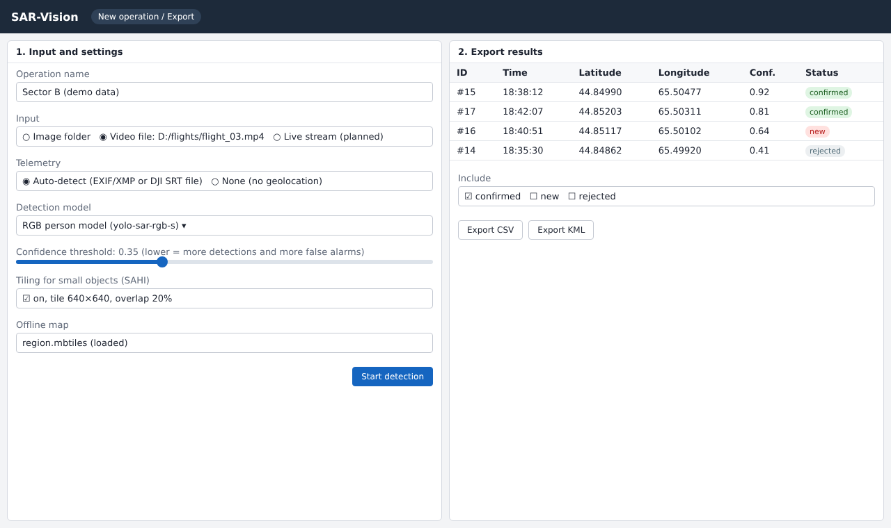

# 8. UX and Prototype

The prototype consists of static mockups of the operator interface, made in HTML. They show the intended workflow and are not screenshots of a working system. All coordinates, file names and detections shown are illustrative. The mockup source is https://github.com/assylzhan-se/uav-sar-vision/blob/prob-period-1/prototype/mockups.html, and the exported images are in https://github.com/assylzhan-se/uav-sar-vision/tree/prob-period-1/prototype. To view the HTML mockups, download the file and open it in a browser.

## 8.1 Operator workflow

1. **Select input.** The operator creates an operation, selects an image folder or video file, and chooses the model, confidence threshold and tiling option (Figure 6, left).
2. **Process and display.** Frames are processed. Possible detections appear as boxes on the frame, as entries in the list and, when telemetry is available, as markers on the map. A short alert is shown for each new detection (Figure 4).
3. **Review.** The operator opens a detection to inspect an enlarged frame and its details, including the assumptions behind the estimated position (Figure 5).
4. **Confirm or reject.** The operator marks the detection as confirmed or rejected and can add a note. The status is saved.
5. **View location.** Confirmed detections are shown in green on the map. Detections without telemetry have no position and are shown only in the list.
6. **Export.** The coordinator exports confirmed detections as CSV or KML (Figure 6, right).

{width=100%}

{width=100%}

{width=100%}

## 8.2 Planned interface between backend and frontend

The backend will expose a small REST API, plus a WebSocket channel for new detections. The endpoints below are a draft and may change during implementation.

| Method | Path | Purpose |
|---|---|---|
| POST | `/api/operations` | Create an operation and set its input |
| POST | `/api/operations/{id}/start` | Start processing |
| GET | `/api/operations/{id}/detections` | List detections, optionally filtered by status |
| PATCH | `/api/detections/{id}` | Confirm or reject a detection and add a note |
| GET | `/api/operations/{id}/export?format=csv` | Export confirmed detections (CSV or KML) |
| WS | `/ws/operations/{id}` | Push new detections to the interface |
